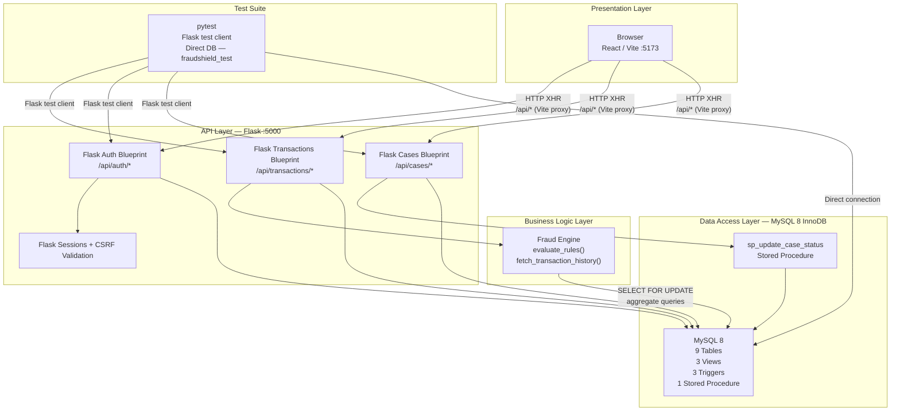

# FraudShield — System Architecture

## Architecture Flowchart

---

## Layer-by-Layer Explanation

### Presentation Layer

The front-end is a **React** single-page application built and served by **Vite** on port **5173**. Vite's development proxy rewrites all requests matching `/api/*` to `http://localhost:5000`, so the browser never needs to manage cross-origin credentials directly. The React app holds no business logic; it renders data returned by the Flask API and dispatches user actions as JSON POST/PUT/GET requests.

### API Layer

The Flask application (port **5000**) is divided into three blueprints:

| Blueprint | Prefix | Responsibility |
|---|---|---|
| `Auth` | `/api/auth` | Login, logout, session management, CSRF token issuance |
| `Transactions` | `/api/transactions` | Create and retrieve transactions; invoke the fraud engine |
| `Cases` | `/api/cases` | Create, retrieve, and update investigation cases and notes |

**Authentication** uses server-side Flask sessions backed by a secret key. Every state-changing request is protected by CSRF validation — the token is issued on login and must accompany subsequent mutating requests.

**Authorization** is enforced at the route level: role claims stored in the session (`admin`, `investigator`) gate access to protected endpoints. The cases blueprint additionally delegates role enforcement to `sp_update_case_status` in the database for reopen operations.

### Business Logic Layer — Fraud Engine

The fraud engine is a Python module invoked synchronously inside the transaction creation route. It performs two phases:

1. **`fetch_transaction_history`** — Executes four aggregate SQL queries against MySQL to retrieve the customer's historical transaction statistics: general lifetime stats, a 10-minute velocity window, a 30-minute failed-transaction window, and a 60-minute location window.
2. **`evaluate_rules`** — A pure-Python function that applies six weighted rules against the fetched history and the current transaction. It accumulates a score (capped at 100) and builds a list of triggered factor descriptions. No database I/O occurs during rule evaluation.

After scoring, the engine persists its output: it upserts a `risk_assessments` record, replaces the associated `risk_factors` rows, and conditionally upserts an `investigation_cases` record when the score is ≥ 60.

### Data Access Layer

MySQL 8 with the InnoDB storage engine provides all persistent storage. The schema consists of:

| Object Type | Count | Purpose |
|---|---|---|
| Tables | 9 | Core relational data store |
| Views | 3 | Pre-joined read-only projections for the API |
| Triggers | 3 | `trg_case_resolved_at` (auto-set resolved_at), `trg_audit_logs_no_update`, `trg_audit_logs_no_delete` (immutability guards on audit_logs) |
| Stored Procedure | 1 | `sp_update_case_status` — enforces state-machine transitions and role-based reopen restriction |

### Test Suite

The `pytest` suite tests the application at two levels:

- **Flask test client** — Sends HTTP requests through the Flask WSGI app without a real network, covering auth flows, transaction creation, and case management endpoints.
- **Direct DB connection** — Connects to the isolated `fraudshield_test` database to verify database-level behaviour: trigger firing, stored procedure enforcement, and data integrity constraints.
