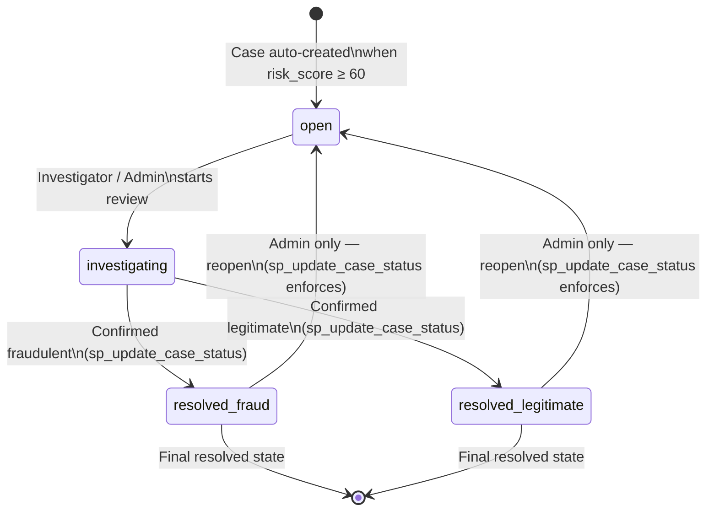

# FraudShield — Investigation Case State Diagram

## State Diagram

---

## State Descriptions

| State | Meaning |
|---|---|
| `open` | The case has been automatically created because the transaction's `risk_score` reached 60 or above. No human review has started yet. |
| `investigating` | An investigator or admin has acknowledged the case and is actively reviewing the transaction details, history, and risk factors. |
| `resolved_fraud` | The review concluded that the transaction is fraudulent. The `resolved_at` timestamp is set automatically by the `trg_case_resolved_at` trigger. |
| `resolved_legitimate` | The review concluded that the transaction is legitimate (a false positive). The `resolved_at` timestamp is set automatically by the trigger. |

---

## Transition Rules

| From | To | Who | Enforcement |
|---|---|---|---|
| *(auto-created)* | `open` | System (Fraud Engine) | `INSERT … ON DUPLICATE KEY UPDATE` in Python when `risk_score ≥ 60` |
| `open` | `investigating` | Admin or Investigator | `sp_update_case_status` |
| `investigating` | `resolved_fraud` | Admin or Investigator | `sp_update_case_status` |
| `investigating` | `resolved_legitimate` | Admin or Investigator | `sp_update_case_status` |
| `resolved_fraud` | `open` | **Admin only** | `sp_update_case_status` — raises `SIGNAL SQLSTATE '45000'` if caller role ≠ `admin` |
| `resolved_legitimate` | `open` | **Admin only** | `sp_update_case_status` — raises `SIGNAL SQLSTATE '45000'` if caller role ≠ `admin` |

---

## Database Enforcement Details

### `trg_case_resolved_at` (BEFORE UPDATE Trigger)

This trigger fires on every `UPDATE` to the `investigation_cases` table. It automatically manages the `resolved_at` column:

- **Entering a resolved state** (`resolved_fraud` or `resolved_legitimate`): sets `resolved_at = NOW()`.
- **Reopening a case** (transitioning back to `open`): clears `resolved_at = NULL`.

This ensures `resolved_at` is always consistent with `case_status` without requiring the application layer to set it explicitly.

### `sp_update_case_status` (Stored Procedure)

The stored procedure is the sole sanctioned method for changing a case's status. It accepts the `case_id`, the `new_status`, and the `caller_role`. Before applying the update it checks:

1. That the transition is valid (e.g., it does not permit jumping from `open` directly to `resolved_fraud`).
2. That if `new_status = 'open'` (a reopen), the `caller_role` is `'admin'`. If not, it raises `SIGNAL SQLSTATE '45000'` with a descriptive message, rolling back the attempted change.

### `trg_audit_logs_no_update` and `trg_audit_logs_no_delete` (BEFORE UPDATE / BEFORE DELETE Triggers)

These two triggers protect the `audit_logs` table by raising `SIGNAL SQLSTATE '45000'` on any attempt to `UPDATE` or `DELETE` an audit record. Every case status transition performed through `sp_update_case_status` results in an audit log entry that is permanently immutable once written.

> [!IMPORTANT]
> The reopen restriction exists at the **database level** inside `sp_update_case_status`, not only in the Flask application layer. This means the restriction is enforced even if the API layer is bypassed and a direct database connection is used.
