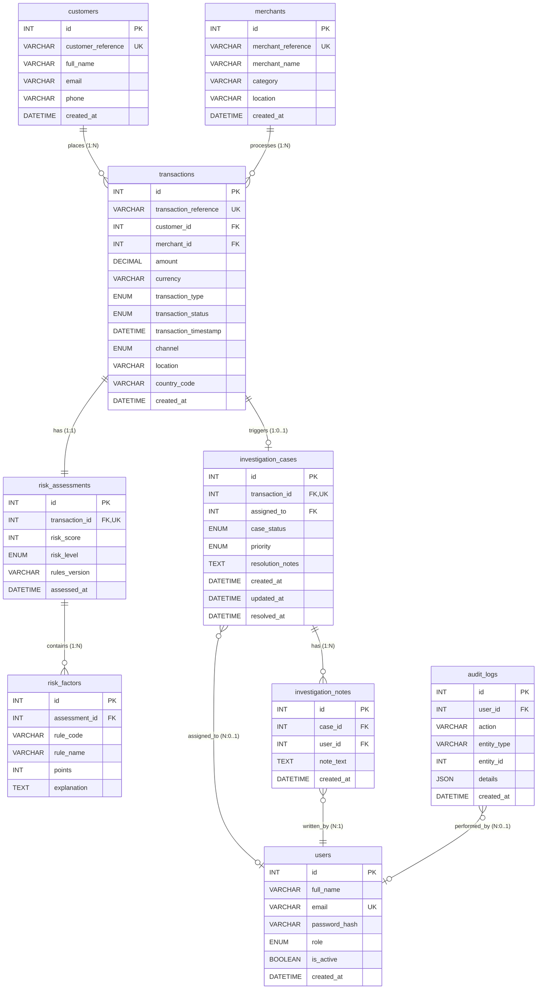

# FraudShield — Entity-Relationship Diagram

## Entity-Relationship (ER) Diagram



---

## Relational Schema Entities & Cardinalities

| Entity | Primary Key | Foreign Keys | Unique Constraints | Cardinality & Relationships |
|---|---|---|---|---|
| `users` | `id` | None | `email` | 1:N with `investigation_cases` (assigned), 1:N with `investigation_notes`, 1:N with `audit_logs` |
| `customers` | `id` | None | `customer_reference` | 1:N with `transactions` (`ON DELETE RESTRICT`) |
| `merchants` | `id` | None | `merchant_reference` | 1:N with `transactions` (`ON DELETE RESTRICT`) |
| `transactions` | `id` | `customer_id`, `merchant_id` | `transaction_reference` | 1:1 with `risk_assessments`, 1:0..1 with `investigation_cases` |
| `risk_assessments` | `id` | `transaction_id` | `transaction_id` | 1:1 with `transactions` (`ON DELETE CASCADE`), 1:N with `risk_factors` |
| `risk_factors` | `id` | `assessment_id` | None | N:1 with `risk_assessments` (`ON DELETE CASCADE`) |
| `investigation_cases` | `id` | `transaction_id`, `assigned_to` | `transaction_id` | 1:1 with flagged `transactions`, 1:N with `investigation_notes` |
| `investigation_notes` | `id` | `case_id`, `user_id` | None | N:1 with `investigation_cases`, N:1 with `users` |
| `audit_logs` | `id` | `user_id` | None | Immutable record stream (`ON DELETE SET NULL`) |

---

## Normalization Analysis

### First Normal Form (1NF) — Atomic Values
- Every attribute in every table stores strictly atomic, indivisible values.
- Repeating groups are eliminated: rather than storing multiple triggered fraud rules or explanations in a comma-delimited string or array within `risk_assessments`, each rule trigger is modeled as an individual tuple in the normalized child table `risk_factors`.
- Similarly, investigator commentary is not accumulated in an unstructured text array, but modeled as distinct atomic records in `investigation_notes`.

### Second Normal Form (2NF) — Full Functional Dependency
- Every relation is in 1NF.
- All tables employ single-attribute surrogate primary keys (`id INT AUTO_INCREMENT`).
- Consequently, no relation has a composite primary key, making partial functional dependencies on a subset of a candidate key mathematically impossible.
- Every non-prime attribute depends on the primary key in its entirety:
  - In `transactions`: `{id} -> {transaction_reference, customer_id, merchant_id, amount, currency, transaction_type, transaction_status, transaction_timestamp, channel, location, country_code, created_at}`
  - In `risk_factors`: `{id} -> {assessment_id, rule_code, rule_name, points, explanation}`

### Third Normal Form (3NF) — Elimination of Transitive Dependencies
- Every relation is in 2NF.
- There are no transitive functional dependencies of the form $X \rightarrow Y \rightarrow Z$, where a non-prime attribute depends on another non-prime attribute:
  - Merchant attributes (`merchant_name`, `category`, `location`) are stored exclusively in `merchants`. `transactions` references only `merchant_id`. If merchant category were stored in `transactions`, a transitive dependency `{transaction_id} -> {merchant_id} -> {category}` would exist, inducing update and insertion anomalies.
  - Customer attributes (`full_name`, `email`, `phone`) reside exclusively in `customers`.
  - Investigator metadata resides in `users`, and is linked via `assigned_to` foreign key without duplicating investigator credentials or email across case records.

---

## Critical Composite Index: `idx_txn_cust_time`

```sql
INDEX idx_txn_cust_time (customer_id, transaction_timestamp)
```

### Architectural Justification:
The FraudShield deterministic rule engine executes four historical profile queries per transaction evaluation:
1. **Lifetime Aggregates:** `WHERE customer_id = %s AND id != %s AND transaction_timestamp <= %s`
2. **Velocity Burst (Rule B):** `WHERE customer_id = %s AND transaction_timestamp BETWEEN (%s - INTERVAL 10 MINUTE) AND %s`
3. **Failed Attempts (Rule D):** `WHERE customer_id = %s AND transaction_status = 'declined' AND transaction_timestamp BETWEEN (%s - INTERVAL 30 MINUTE) AND %s`
4. **Location Consistency (Rule F):** `WHERE customer_id = %s AND transaction_timestamp BETWEEN (%s - INTERVAL 60 MINUTE) AND %s ORDER BY transaction_timestamp DESC LIMIT 1`

By indexing `(customer_id, transaction_timestamp)` as a leftmost-prefix composite index, MySQL performs an efficient `ref` range scan directly within the B-Tree leaf nodes for the target customer, eliminating full table scans across millions of transaction records.
