# FraudShield — Fraud Scoring Algorithm Flowchart

## Scoring Flowchart

```mermaid
flowchart TD
    Start([Start: Transaction submitted]) --> LoadTxn

    LoadTxn["Load transaction from DB\nSELECT ... FOR UPDATE lock\n(joins merchants + customers)"]
    LoadTxn --> FetchHistory

    FetchHistory["Fetch 4 history queries\n① General stats (lifetime)\n② Velocity — 10-min window\n③ Failed txns — 30-min window\n④ Location — 60-min window"]
    FetchHistory --> Init

    Init["Initialize\nscore = 0\nfactors = []"]
    Init --> RuleA

    RuleA{"Rule A\namount ≥ 5000?"}
    RuleA -- "YES → +25" --> RuleB
    RuleA -- "NO" --> RuleB

    RuleB{"Rule B\nrecent_10m_count ≥ 3?"}
    RuleB -- "YES → +20" --> RuleC
    RuleB -- "NO" --> RuleC

    RuleC{"Rule C\nprior_count ≥ 3\nAND amount ≥ 3.0 × avg?"}
    RuleC -- "YES → +20" --> RuleD
    RuleC -- "NO" --> RuleD

    RuleD{"Rule D\nrecent_failed_count ≥ 2?"}
    RuleD -- "YES → +15" --> RuleE
    RuleD -- "NO" --> RuleE

    RuleE{"Rule E\nprior_count ≥ 3\nAND prior_with_merchant = 0?"}
    RuleE -- "YES → +10" --> RuleF
    RuleE -- "NO" --> RuleF

    RuleF{"Rule F\nlast_recent_country exists\nAND ≠ current country?"}
    RuleF -- "YES → +20" --> Finalize
    RuleF -- "NO" --> Finalize

    Finalize["final_score = min(100, total_points)"]
    Finalize --> RiskLevel

    RiskLevel["Assign risk_level\n0–29  → Low\n30–59 → Medium\n60–79 → High\n80–100 → Critical"]
    RiskLevel --> ScoreCheck

    ScoreCheck{"score ≥ 60?"}

    ScoreCheck -- "YES" --> UpsertCase
    ScoreCheck -- "NO" --> NoCase

    UpsertCase["Upsert investigation_case\npriority = critical if Critical\npriority = high otherwise\n(ON DUPLICATE KEY UPDATE)"]
    NoCase["No case created"]

    UpsertCase --> PersistAssessment
    NoCase --> PersistAssessment

    PersistAssessment["Upsert risk_assessment\n(ON DUPLICATE KEY UPDATE)\n+\nDELETE + INSERT risk_factors"]
    PersistAssessment --> AuditLog

    AuditLog["INSERT INTO audit_logs\n(immutable — protected by triggers)"]
    AuditLog --> End

    End(["End: Return result JSON\n{ transaction_id, risk_score,\nrisk_level, factors,\ncase_id, is_flagged }"])
```

---

## Rule Reference Table

| Rule | Condition | Score Added | Fraud Signal |
|---|---|---|---|
| **A — High Value** | `amount ≥ 5000` | +25 | Unusually large single transaction |
| **B — Rapid Velocity** | `recent_10m_count ≥ 3` | +20 | Multiple transactions within 10 minutes |
| **C — Amount Spike** | `prior_count ≥ 3` AND `amount ≥ 3.0 × avg_amount` | +20 | Current amount is 3× the customer's historical average |
| **D — Recent Failures** | `recent_failed_count ≥ 2` | +15 | Two or more failed transactions in the past 30 minutes |
| **E — New Merchant** | `prior_count ≥ 3` AND `prior_with_merchant = 0` | +10 | Customer has history but has never used this merchant |
| **F — Location Shift** | `last_recent_country` exists AND differs from `current country` | +20 | Transaction country differs from country seen in last 60 minutes |

> [!NOTE]
> `evaluate_rules()` is a pure-Python function. All six rules are evaluated independently against the same pre-fetched history snapshot; no additional database queries are made during scoring. The final score is capped at **100** via `min(100, total_points)`.

## Risk Level Thresholds

| Range | Level | Investigation Case? |
|---|---|---|
| 0 – 29 | Low | No |
| 30 – 59 | Medium | No |
| 60 – 79 | High | Yes — priority `high` |
| 80 – 100 | Critical | Yes — priority `critical` |
