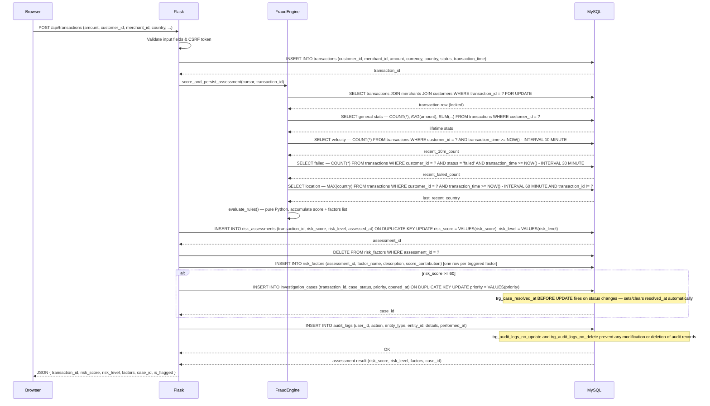

# FraudShield — Transaction & Fraud Scoring Sequence Diagram

## Sequence Diagram

---

## Step-by-Step Narrative

| Step | Actor | Action |
|---|---|---|
| 1 | Browser → Flask | HTTP POST to `/api/transactions` carrying transaction fields in the JSON body along with the CSRF token. |
| 2 | Flask | Validates all required fields and checks the CSRF token before touching the database. |
| 3 | Flask → MySQL | Inserts the new transaction row and receives the auto-generated `transaction_id`. |
| 4 | Flask → FraudEngine | Calls `score_and_persist_assessment`, passing the active cursor and the new `transaction_id`. |
| 5 | FraudEngine → MySQL | Locks the transaction row with `SELECT … FOR UPDATE` to prevent concurrent scoring races, joining `merchants` and `customers` for context. |
| 6–9 | FraudEngine → MySQL | Executes four aggregate queries to build the customer's historical context: lifetime stats, 10-minute velocity, 30-minute failure rate, and 60-minute location window. |
| 10 | FraudEngine | Runs `evaluate_rules()` — a pure-Python function with no further I/O — and produces a final score (0–100) and a list of triggered factor objects. |
| 11 | Flask → MySQL | Upserts the `risk_assessments` record using `ON DUPLICATE KEY UPDATE` to handle reprocessing safely. |
| 12 | Flask → MySQL | Clears and re-inserts `risk_factors` rows to keep them in sync with the current score. |
| 13 | Flask → MySQL | If `risk_score ≥ 60`, upserts an `investigation_cases` record. The `trg_case_resolved_at` trigger fires automatically on any status-column UPDATE to manage the `resolved_at` timestamp. |
| 14 | Flask → MySQL | Writes an `audit_logs` record. The `trg_audit_logs_no_update` and `trg_audit_logs_no_delete` triggers ensure no one can alter or erase audit entries after they are written. |
| 15 | MySQL → Flask | Returns the persisted assessment data. |
| 16 | Flask → Browser | Returns a JSON response containing `transaction_id`, `risk_score`, `risk_level`, `factors`, `case_id` (or `null`), and `is_flagged`. |
