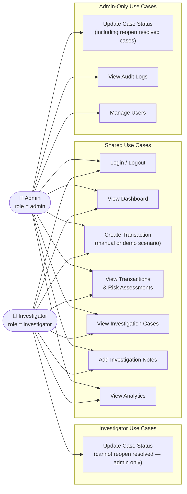

# FraudShield — Use Case Diagram

> [!NOTE]
> Mermaid does not support native UML use-case diagram syntax. The diagram below uses a `flowchart LR` as a structured substitute, grouping use cases by actor role.

## Use Case Diagram (Flowchart Substitute)

---

## Use Case Descriptions

### Shared Use Cases

| Use Case | Description |
|---|---|
| **Login / Logout** | Both roles authenticate with username and password. Flask issues a session cookie and CSRF token on successful login. Logout invalidates the server-side session. |
| **View Dashboard** | Displays summary KPIs: total transactions, flagged count, open cases, and recent activity. Available to all authenticated users. |
| **Create Transaction** | Submits a new financial transaction (customer, merchant, amount, currency, country). The fraud engine scores it immediately. Users may also trigger pre-built demo scenarios to showcase specific fraud rules. |
| **View Transactions & Risk Assessments** | Browse paginated transaction history with associated risk scores, risk levels, and triggered factor details. |
| **View Investigation Cases** | List all investigation cases with status, priority, assigned user, and linked transaction. |
| **Add Investigation Notes** | Append timestamped, user-attributed notes to any investigation case to document review findings. |
| **View Analytics** | View aggregate statistics: score distributions, risk-level breakdowns, top triggered rules, and case resolution rates. |

### Admin-Only Use Cases

| Use Case | Description |
|---|---|
| **Update Case Status (Admin)** | Transition a case through all valid states. Admins are the **only** role permitted to reopen a resolved case (`resolved_fraud` or `resolved_legitimate` → `open`). This is enforced by `sp_update_case_status` via a `SIGNAL SQLSTATE '45000'` when a non-admin attempts a reopen. |
| **View Audit Logs** | Inspect the immutable `audit_logs` table, which records every significant action with the acting user, entity type, entity ID, and timestamp. Audit records cannot be updated or deleted (enforced by triggers). |
| **Manage Users** | Create, view, and manage user accounts and their assigned roles (`admin` or `investigator`). |

### Investigator Use Cases

| Use Case | Description |
|---|---|
| **Update Case Status (Investigator)** | Investigators may move cases from `open` → `investigating`, `investigating` → `resolved_fraud`, or `investigating` → `resolved_legitimate`. They **cannot** reopen resolved cases; that action is restricted to the `admin` role. |
